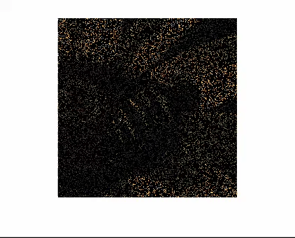

# SGLN-LRQMC

Official implementation of **SGLN-LRQMC** for color image completion. The method combines quaternion-aware global structure modeling with complementary learned and nonlocal image priors in an iterative reconstruction framework.

## Demo

The following short example reconstructs **Bee** using a random mask at **MR = 0.85**. Click the preview to open the full-resolution video.

[](assets/Bee_Demo.mp4)

## Repository layout

```text
SGLN-LRQMC/
├── main_SGLN_LRQMC.py     # Command-line entry point
├── src/                   # Reconstruction algorithm and CBM3D bridge
├── utils/                 # Quaternion, metric, and denoiser utilities
├── config/                # Typed experiment configuration
├── FFDNet_pytorch/        # FFDNet architecture and checkpoint
├── DRUNet_pytorch/        # DRUNet architecture and checkpoint
├── Dataset/               # Example images and binary masks
└── assets/                # Demonstration media
```

## Environment

The implementation requires a CUDA-capable GPU. Create a Python environment (Python 3.10 or newer is recommended), then install the lightweight dependencies:

```bash
pip install -r requirements.txt
```

Install a PyTorch build and a CuPy build compatible with your local CUDA runtime. For example, consult the official installation guides for [PyTorch](https://pytorch.org/get-started/locally/) and [CuPy](https://docs.cupy.dev/en/stable/install.html).

The nonlocal branch also requires a CUDA-compatible `bm3d_cupy` module. Make sure it is importable in the active environment before running the program.

The DRUNet checkpoint is stored with Git LFS. After cloning, retrieve large files with:

```bash
git lfs install
git lfs pull
```

## Quick start

Run the bundled CSet12 example from the repository root:

```bash
python main_SGLN_LRQMC.py \
  --dataset CSet12 \
  --image Airplane \
  --mr 0.85 \
  --local-denoiser ffdnet \
  --output outputs/Airplane_MR85.png
```

To use DRUNet in the local-prior branch, replace the denoiser option:

```bash
python main_SGLN_LRQMC.py \
  --dataset CSet12 \
  --image Peppers \
  --mr 0.85 \
  --local-denoiser drunet \
  --output outputs/Peppers_MR85_DRUNet.png
```

You can also specify an arbitrary image and binary mask:

```bash
python main_SGLN_LRQMC.py \
  --img-path /path/to/image.png \
  --mask-path /path/to/mask.png \
  --lambda 1.0 \
  --alpha 0.1 \
  --gamma 20 \
  --eta 20 \
  --iterations 100 \
  --output outputs/reconstruction.png
```

The mask uses `1` for observed pixels and `0` for missing pixels. The bundled masks follow the naming convention `Dataset/Mask_XX.png`, where `XX` is the missing percentage.

## Command-line interface

```bash
python main_SGLN_LRQMC.py --help
```

Common options include:

| Option | Description |
| --- | --- |
| `--dataset`, `--image` | Select a bundled test image. |
| `--img-path`, `--mask-path` | Provide custom image and mask files. |
| `--mr` | Select the bundled missing-ratio mask. |
| `--local-denoiser` | Choose `ffdnet` or `drunet`. |
| `--lambda`, `--alpha`, `--gamma`, `--eta` | Set reconstruction and prior weights. |
| `--mu`, `--rho`, `--mu-max` | Set the penalty schedule. |
| `--iterations`, `--tol` | Control the iteration budget and stopping criterion. |
| `--equivariant-pnp`, `--no-equivariant-pnp` | Enable or disable the transformation-based stabilization. |
| `--output` | Save the reconstructed color image. |

## Reproducibility

The command-line entry point fixes the random seed by default (`--seed 0`). For a controlled comparison, use the same image, mask, parameter set, and seed across runs.

## Citation

If you find this repository useful, please cite the accompanying SGLN-LRQMC paper. Citation metadata will be added once the manuscript is publicly available.

## Acknowledgements

The repository includes pretrained denoising components based on FFDNet and DRUNet. Please refer to the respective upstream projects and publications when using those components.
